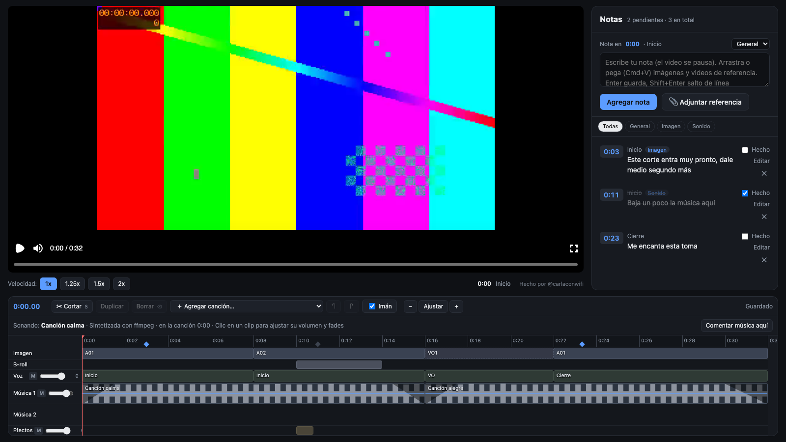

# Editor visual

Una página local para revisar el corte de un video y dejar notas a quien lo edita.



- **Notas pegadas al segundo.** Pausas, escribes y la nota queda en ese momento del video. Puedes ponerle una categoría, adjuntar imágenes o videos de referencia (arrastrándolos o pegándolos con Cmd+V) y marcarla como hecha.
- **Línea de tiempo.** Muestra la imagen, el b-roll, la voz, dos pistas de música y los efectos. Los clips de música se pueden mover, recortar, cortar, duplicar y borrar, y se les puede cambiar el volumen y los fundidos. Cada pista se puede silenciar.
- **Todo se queda en tu computador.** Las notas y los cambios se guardan como archivos JSON dentro de la carpeta del proyecto.

El video se arma con [Remotion](https://www.remotion.dev) a partir de una lista de cortes en JSON, así que no hace falta exportar nada para revisarlo.

## Probarlo

Necesitas [Node.js](https://nodejs.org) 18 o más reciente.

```bash
npm install
npm run editor
```

Abre http://localhost:3100. Verás un proyecto de ejemplo hecho con barras de color y tonos sintéticos. En el ejemplo solo suenan la música y un efecto en el segundo 10: la pista "Voz", que en un proyecto real lleva el sonido de cada toma, va en silencio porque ahí no habla nadie.

Para abrir tu propio proyecto:

```bash
npm run editor -- ruta/a/mi/proyecto
```

Puedes cambiar el puerto con `PORT=4000`. Por defecto el editor solo se ve desde tu computador; si quieres abrirlo desde otro equipo de tu red, arráncalo con `HOST=0.0.0.0`.

## Formato del proyecto

```
mi-proyecto/
  edl/video.json          obligatorio: los tramos del corte
  edl/broll.json          opcional: b-roll y efectos de sonido
  edl/music_edit.json     opcional: clips de música (el editor lo reescribe al editar)
  audio/music/*.mp3       canciones disponibles
  audio/music/library.json
  media/...               tus tomas (las rutas van en los JSON)
```

Al revisar, el editor crea `notas_revision.json` y `revision_adjuntos/` en esa misma carpeta.

### edl/video.json

```json
{
  "fps": 30,
  "total": 32,
  "segments": [
    { "block": "inicio", "title": "Inicio", "clip": "A01", "kind": "A", "src": "media/toma_a.mp4", "a": 0, "t": 0 },
    { "block": "medio", "title": "Voz en off", "clip": "VO1", "kind": "VO", "src": "media/voz.m4a", "a": 0, "t": 16 }
  ]
}
```

- `t`: segundo del video final en que empieza el tramo. Cada tramo dura hasta que empieza el siguiente, y el último hasta `total`.
- `src` y `a`: el archivo y el segundo de ese archivo desde donde se toma.
- `kind`: `"A"` es una toma con imagen y sonido. `"VO"` es una voz en off: suena el audio y se ve una pantalla de relleno.
- Opcionales: `intro` (segundos) e `intro_src` (archivo), si el video arranca con una intro ya montada.

### edl/broll.json

```json
{
  "items": [{ "t": 10, "dur": 4, "src": "media/broll_1.mp4", "a": 0, "why": "nota opcional" }],
  "sfx": [{ "t": 10, "file": "sfx/pop.wav", "vol": 0.5 }]
}
```

### Música

Pon tus `.mp3` en `audio/music/` y corre:

```bash
python3 scripts/picos.py ruta/a/mi/proyecto
```

Ese script arma `library.json` con la duración y la forma de onda de cada canción. Necesita `ffmpeg`. Después puedes editar a mano el título, el artista y el volumen inicial de cada canción en `library.json`.

Para regenerar el ejemplo: `npm run ejemplo` (también necesita `ffmpeg`).

### ¿No tienes música?

Para música y efectos de sonido sin problemas de derechos de autor en YouTube, yo uso Epidemic Sound: https://conwi.fi/epidemicsound

*Es un enlace de afiliado: si te suscribes desde ahí, me llevo una comisión y a ti no te cuesta más.*

## Licencias

El código de este repositorio es MIT (ver `LICENSE`). Depende de Remotion, que tiene su propia licencia: es gratis para personas y equipos pequeños, pero algunas empresas tienen que pagarla. Revisa https://www.remotion.dev/license antes de usarlo en una empresa.

Usa solo música, tomas y efectos que tengas derecho a usar. Los del ejemplo los generó ffmpeg.

## Hecho por Carla Con Wifi

Soy **@carlaconwifi** en todas las redes: [YouTube](https://www.youtube.com/@carlaconwifi) · [Instagram](https://www.instagram.com/carlaconwifi) · [TikTok](https://www.tiktok.com/@carlaconwifi)

Si el editor te sirve, sígueme. Y si subes algo que revisaste con él, etiquétame: me encanta ver qué hacen.
